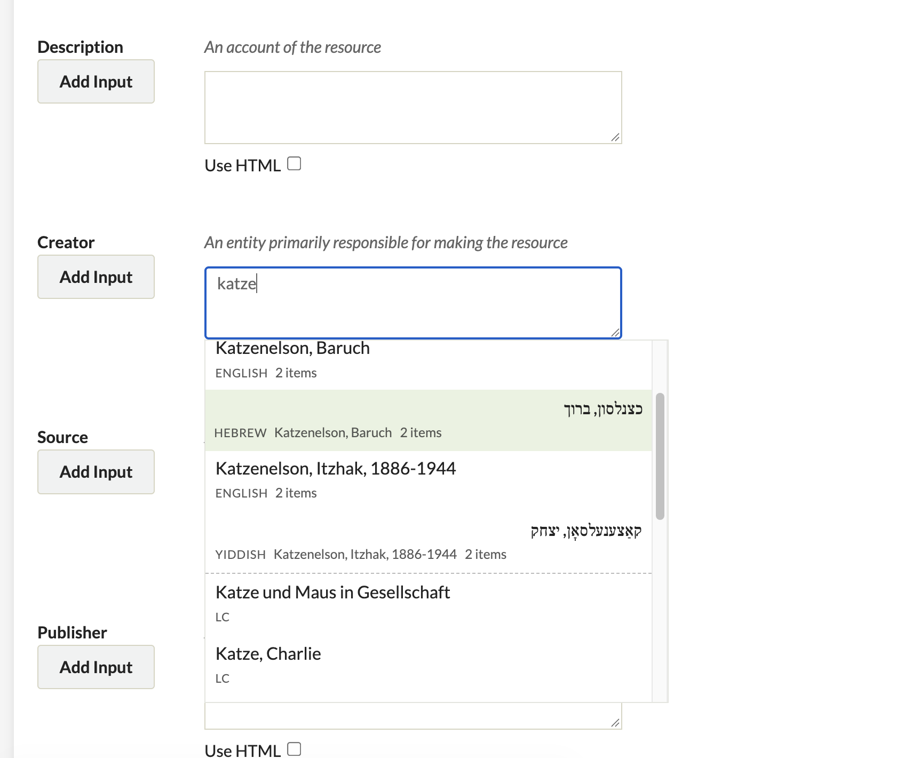
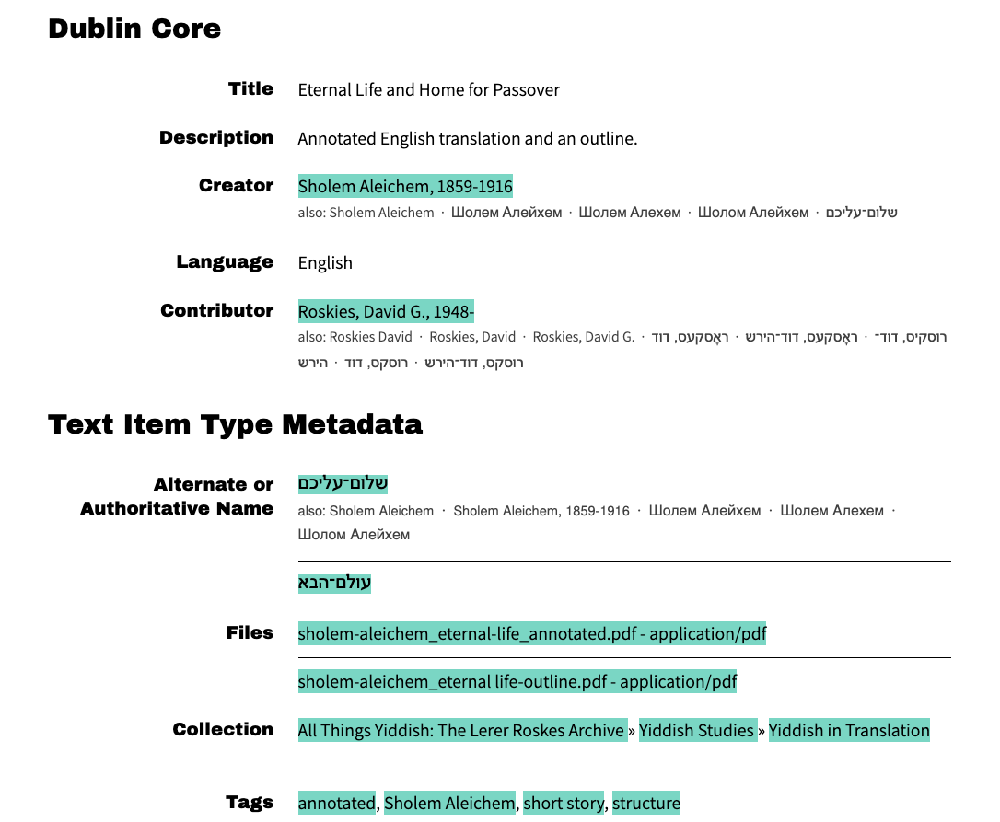
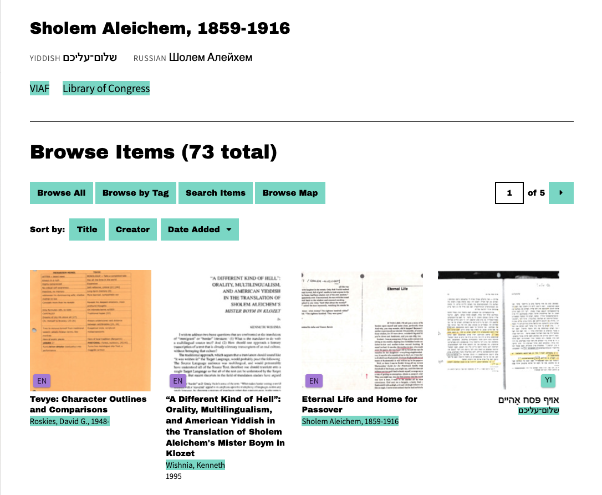

# Name Authority (Omeka Classic plugin)

One record per person (or corporate body / topic):

- an **authoritative name**, usually the LC heading (e.g. *Tolstoy, Leo, graf, 1828-1910*);
- **one form per language**, used on items in that language (English *Leo Tolstoy*, Russian *Лев Толстой*, German *Lew Tolstoi* …);
- **search variants**: other names and spellings that should find the person but aren't shown on items. How you use them is up to you: other romanizations and old spellings, for instance, or a real name, so that a search for *Clemens* finds the items under *Mark Twain*;
- optional **VIAF** and **LC** identifiers.

Item values are left as they are: the plugin matches them to records, so it works with an existing collection without changing any metadata.

| Item form | Item page | Clicked name |
|---|---|---|
|  |  |  |

## What it does on the public site

### Clicked names find every form

A click on a name on an item page shows all of that person's items, under every form and variant, in every language.

**If names on your site are already clickable** (for example, made into links by the Search By Metadata plugin), each link searches for items whose field matches that exact name, with a URL like:

```
items/browse?advanced[0][element_id]=39&advanced[0][type]=is exactly&advanced[0][terms]=Mark Twain
```

On its own, that search finds only items with exactly that spelling. Name Authority works with these existing links as they are, but widens the search to the person's other forms and variants: a click on *Mark Twain* also finds items catalogued under *Марк Твен* or *Clemens, Samuel Langhorne*. This applies to the name fields chosen in the settings (by default *Creator*, *Contributor* and *Subject*). Setting: *Clicked names find every form*.

**If names on your site are not clickable**, turn on *Make names clickable* in the plugin settings, and Name Authority links each name to the person's items itself. Leave it off if another plugin already makes names clickable, or names will be linked twice.

### Other features

| Feature | Setting |
|---|---|
| **Searches find variants.** Item search (`items/browse?search=`) and the site search find the person under any form or variant, e.g. "Clemens" finds Mark Twain if *Clemens, Samuel Langhorne* is one of his variants. The site search needs a re-index after names are changed. | *Searches find variants* |
| **"also:" line** under each name on item pages, listing the person's forms in the other languages. | *"Also:" under names* (+ *…including search variants*) |
| **Person banner** above the results of a clicked name: authoritative name, forms by language, VIAF / LC links. | *Person banner on results*, *VIAF and LC identifiers* |

Matching between item values and name forms ignores case, extra or non-breaking spaces, line breaks, hyphens and dashes, brackets, and ligatures. It therefore works the same before and after a metadata clean-up.

## Item form

Typing two or more letters in a name field on the item add/edit form (the name fields chosen in the settings) suggests matching name records, in any language or spelling (typing *clemens* can offer Mark Twain). Picking one fills in:
- the record's form in the **item's language** (from its Language field), e.g. the German form on a German item;
- or the **authoritative name**, in the field chosen for authoritative headings (optional; see Settings).

If a record has no form in the item's language, its other forms are offered and marked "no German form" (or whichever language). The most-used records come first. Where **LC Suggest** is set for the same field, LC's suggestions follow in the same list, marked LC. If LC is slow or unreachable, your records still appear. Anyone who can add items gets the suggestions. Turn it off with *Suggest names while typing* in the settings.

## Admin

**Name Authority** in the admin menu. The top of the page shows an overview. Each count links to those records:
- how many records have no authoritative name, a VIAF ID or an LC ID, or are on no item;
- how many are monolingual, in two languages, in three or more, or authoritative name only, and how many have a form in each language;
- how many search variants there are;
- how many possible duplicates there are;
- how many records are used on items only in topic fields (Subject by default), which helps find topics that were imported as names by mistake;
- how many names and how many topics on items have no record: values that match none of the records' names, forms or variants. Each opens its own tab (**Names** and **Topics**), most items first, with links to find similar records or add one. Adding a record for a topic makes it clickable, like a name.
- **Delete several records at once**: tick them in the list and click **Delete ticked**. A confirmation page lists them first. Item metadata isn't changed.


- **Browse / search** names in any language. Sort by authoritative name or by number of items (click **Items**: most-used first, click again for fewest). Filter "only names without an authoritative form". The item count links to the person's items.
- **Add / edit**: authoritative name; forms by language, one per line as `Language: name`; search variants, one per line; VIAF / LC IDs; private notes.
- **Previous / Next**: a record opened from the list keeps that list (search, filters, sort), with **← Previous**, **Next →**, its position ("51 of 774") and **Save and next** for working through many records. With a filter like "without an authoritative name", saving can take the record out of the list; Save and next still goes to the record that was next.
- **Import TSV**: a sheet of names (see [Building an import sheet](docs/building-an-import-sheet.md)), or a file exported here.
  - *Add new names* skips names that already exist.
  - *Replace everything* deletes all records first.
- **Export TSV**: everything, in the same format, for OpenRefine or a spreadsheet. Exporting and re-importing gives exactly the same records.
- **Re-index search**: rebuilds the site-search index so it includes forms and variants. This is the same job as *Settings → Search → Index Records*.
- **Look up in VIAF** (edit page, under the VIAF / LC fields): searches VIAF for the name and lists matching people and organisations, each with its VIAF ID and, where the Library of Congress has a record, its LC ID. **Use** fills in both fields. It then fetches LC's own heading from the VIAF record (e.g. *Twain, Mark, 1835-1910*):
  - if the authoritative name is empty, it's filled in;
  - if it differs, both are shown with **Use as authoritative name**, which also moves the old name to the search variants.

  Then Save. If another name record already has that ID, the result says so. There are also plain links to search viaf.org and id.loc.gov by hand. id.loc.gov isn't queried directly because it blocks automated requests.
- **Possible duplicates**: pairs of name records that may be the same person. A pair is suggested when the records:
  - share a name form;
  - have the same VIAF or LC ID;
  - have the same name apart from dates (*Smith, Jane* / *Smith, Jane, 1950-*); or
  - have the same surname with a matching first name or initial (*Smith, J.* / *Smith, Jane*). This rule is the loosest and sometimes pairs different people.

  Each pair is shown side by side.
  - **Keep this one, merge the other into it** keeps one record and moves the other's names into it: as forms for languages it doesn't have yet, otherwise as search variants. It also moves the VIAF / LC IDs and notes, and adds a note recording the merge. Item metadata isn't changed.
  - **Not the same** hides the pair for good.

  Flagged records are marked "possible duplicate" in the list, and their edit page shows the suggestions.
- **Merge any two records**, including ones the plugin doesn't suggest:
  - in the list, tick two names and click **Compare and merge the two ticked names**;
  - or, on a record's edit page, click **Merge with another record…** and search for the other one.

  Both open the same side-by-side comparison with the **Keep this one** buttons.
- **Searching the list** finds names in any language or spelling. It ignores ligatures, accents and other diacritics, hyphens and word order, so *Tolstoi Leon* finds *Tolstoï, Léon*.

## Settings

*Plugins → Name Authority → Configure*:
- **Fields that hold names.** Default: Dublin Core Creator, Contributor, Subject. Any field from any element set can be added.
- **Fields that mostly hold topics.** Default: Subject. Listed separately under *Topics with no record*.
- **Field for the authoritative heading.** Optional, none by default. If your items have a field for the authoritative form of a name, choose it, and the item form suggests authoritative headings there.
- **Field with the item's language.** Default: Dublin Core Language. The item form uses it to suggest the form in the item's language. Language names or codes both work (German, ger, de).
- **On/off switches** for each feature above.

## Install

1. Download `NameAuthority.zip` from the latest [release](https://github.com/raphihalff/omeka-plugin-NameAuthority/releases).
2. Unzip it into your Omeka `plugins/` folder. The folder must be named `NameAuthority`.
3. **Plugins → Name Authority → Install**, then check the settings.
4. Add names one at a time, or import a sheet: **Name Authority → Import TSV** (see [Building an import sheet](docs/building-an-import-sheet.md)).
5. **Re-index search** after importing.

Requirements: Omeka Classic 3.x and PHP 7.4+. Tested on Omeka 3.2.2 with PHP 8.3 and 8.5. The `intl` extension is used if present, but isn't required.

## Uninstall

Removes the two tables (`name_authorities`, `name_authority_forms`) and the settings, including the list of pairs marked "not the same". Item metadata isn't touched.

## Upgrading

Replace the `NameAuthority` folder, then go to **Plugins** and click **Upgrade** next to Name Authority. Your names are kept.
